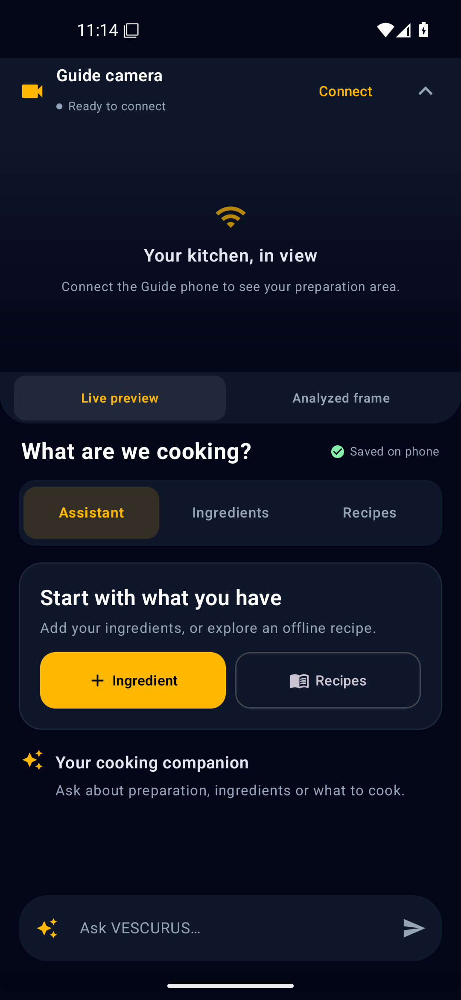
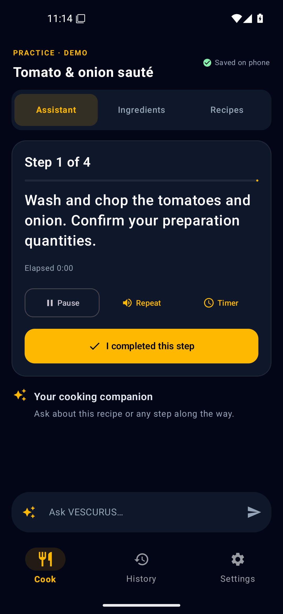

# VESCURUS exhibition build

22 November 2026. Kotlin/Compose; existing Guide, Cook and Demonstration roles retained.
The role picker presents them as Camera phone, Cooking phone and Practice session.
Live scale transport and mounted calibration are not integrated in this branch.
Enter externally measured amounts manually, or leave quantities unknown.

## Setup

1. Install `app/build/outputs/apk/debug/app-debug.apk` on both phones.
2. Connect both phones to the same internet-capable Wi-Fi/hotspot. USB debugging is
   for installation/testing; it is not the application transport.
3. Select **Camera phone** on Guide and **Cooking phone** on the companion.
4. On Cook, enter the Guide address, port **8766**, and its six-digit pairing code.
   The connection status must show the phones are connected. Session/version details
   are available under **Settings → Advanced details** when investigating a problem.
5. Guide: tap **Analyze scene**, or deliberately enable Auto. Cook's camera is visible
   by default in portrait. Choose **Live preview** or the matching **Analyzed frame**.
6. In **Ingredients**, review a camera proposal or add an ingredient manually. Enter
   a measured amount or leave it unknown. Confirm addition separately after transferring it.
7. In **Recipes**, search Spoonacular, choose a saved result, or browse offline recipes.
   Check recipe ingredients and additional ingredients separately.
8. Choosing a recipe returns to **Assistant**. Start cooking, explicitly complete steps,
   and confirm final completion. Pause/resume and step reminders remain available.
   Timer expiry only prompts a check. Chat is available before and during cooking.
9. **History** retains completed sessions and saved drafts. **Settings** exports JSON
   through Android's document picker. Practice records remain separate from live records.

## Backend and local data

The Guide phone hosts the existing Ktor WebSocket service. Cook owns recipe choice,
confirmed entries, correction/undo audit, step and pause state. Guide receives small
session/version/context updates and supplies frame-bound observations and bounded
live frames. There is no separately hosted backend, cloud database, new subscription,
or required laptop server. `/health` on Guide identifies protocol 2.

Phone-private storage: `files/sessions/cooking.json`, `demonstration.json`, their
previous-valid backups, and retrieved `recipes.json`. Writes use a fsynced pending
file and replacement, with recovery rather than overwriting malformed data. Startup
retains session identity; recovered cooking resumes paused. Only the latest pending
full-state write is queued; every committed entry is included in that snapshot.
Android automatic backup is disabled; intentional export is available in Settings.
Export includes schema/session/event IDs, units, evidence source, confirmation and
correction history. It omits API keys and camera image data.

Cloud vision: explicit Gemini `gemini-3.1-flash-lite` REST requests with shared prompt
and strict schema. Spoonacular uses the existing key in an HTTP header, explicit
error states, source recipe IDs/attribution, saved local results and honest missing
nutrition. Existing APK-embedded keys remain extractable; they are not production
secret protection. No keys or Wi-Fi credentials were added to Git or logs.

No usable local model asset exists. The unused, non-16-KB-aligned ONNX 1.17 runtime
was removed. The old implementation is retained under `tools/reference/` for future
verification. Local mode explicitly reports unavailable and never silently switches
providers. Missing nutrition is unavailable. Built-in guides are labelled as such,
not presented as Spoonacular results or measured food intake.

## Cook interface refresh

The UI combines the camera/chat presentation of `198b88a` with the CV and session
implementation of `87752d3`. Live video has no detection boxes. Analysis displays
the exact image and dimensions supplied by its observation. Camera capture,
recognition, transport, freshness and session reducers were retained.

- The existing startup logo fade/scale animation and screen transition are retained.
  A fresh launch shows the entrance before opening the saved phone role. Restored
  screen state after the entrance avoids replaying it on ordinary activity recreation.
- Cook has Assistant, Ingredients and Recipes workspaces, with a persistent chat
  composer in Assistant. The current instruction appears above conversation.
- The camera minimizes for the keyboard and small viewports; it can also be collapsed.
- Session IDs, revisions, engine and frame details are in Settings disclosures.
  Recognition failures, connection problems and save errors remain visible.
- Assistant requests include recent conversation and the current confirmed session.
  Replies and speech are cleared when switching sessions. Chat requests do not
  include a camera image and must not claim to observe food.
- Guide's history is read-only; draft resumption is available in Cooking/Practice.
- `CookPreviews.kt` uses current components, including a narrow, larger-font recipe
  card. These are component previews, not a simulated full-screen workflow.

## Verification of this UI refresh

The application revision was verified by [GitHub Actions run 45015967411](https://github.com/KVS-Surya-Teja/VESCURUS_expo/actions/runs/45015967411)
at commit `3f056a58ceef3b16bb81ae5af296a101df7ed885`:

- Debug application and Android test APKs compiled successfully.
- **33 JVM tests passed**. New assistant-context cases cover conversation history,
  recipe/step context, distinct units, unknown quantities and bounded history.
- **5 Android tests passed** on an Android 15/API 35 Pixel 5 emulator. These cover
  camera/chat reachability, explicit non-egg recipe completion, pause/resume,
  timer behavior, storage recovery and the existing loopback protocol checks.
- Lint completed with **0 errors**, 86 warnings and 2 hints. Existing dependency,
  resource and style warnings remain; this is not a warning-free build.

These checks use isolated test/manual data and do not call live cloud vision or
Spoonacular. The physical-phone evidence below belongs to the preceding CV build;
it does not establish that this UI revision has been installed on either phone.
After pulling and building locally, install the same APK on both phones and check
live video, a matching analyzed frame, chat, and recipe pause/save/resumption.

### Native UI review

These unedited images come from the successful Android emulator run above.
Cook home is an isolated CookScreen with safe system insets and no paired camera;
the active step is the full app shell in explicitly labelled Practice mode, using
manual Tomato/Onion test data. They demonstrate layout, not live recognition or
weighing. The former image intentionally omits the outer shell navigation.

| Camera and Assistant workspace | Active cooking and chat |
| --- | --- |
|  |  |

The CI runner clears only a specifically identified background Pixel Launcher ANR
if it obstructs review; application errors and test failures remain visible. Full
reports and additional captures are retained in the linked run's artifact.

## Previous physical build verification (`87752d3`)

- Latest JVM run: **29 tests passed**; actual results are retained under
  `app/build/test-results/testDebugUnitTest`. Optional CV/API adapter: **17 tests passed**.
- Final Android run: **4 tests passed** on the Redmi. The non-egg tomato/onion
  workflow verifies manual entries, timer not advancing the step, pause/resume,
  completion, reload and history. Separate cases cover Android corruption recovery
  and real loopback pairing/session/frame/reconnect/heartbeat behavior. Protocol
  fixtures are explicitly test data, not recognition evidence. MIUI requires the
  test activity to be foregrounded after instrumentation starts; the helper handles
  this and checks that the device is unlocked before starting.
- Real phone camera: user-confirmed Pomegranate, corroborated by logs; then a saved
  real Rusk image recognized as Rusk (score 0.98, 3,919 ms inference) and delivered to
  Samsung with identical session/stream/frame identity, frame 729. A subsequent
  no-food frame 1068 was received and rendered (2,690 ms inference).
- Guide: Redmi 22101316I, Android 13/API 33. Cook: Samsung SM-M307F, Android 11/API 30.
  Both were verified on the 192.168.0.x Wi-Fi network after correcting the initial
  different-subnet setup and one mistyped address.
- Cold-start check: the real app restored its same demonstration session and manual
  Tomato 200 g entry after force-stop/relaunch.
- Actual Android document-picker export saved to Downloads and was pulled/parsed;
  session identity, MANUAL evidence and GRAMS were verified.
- Actual Spoonacular request from the phone returned source-attributed recipes and
  nutrition. Reviewing the result found an unsupported water-cooking method; its
  phrase was added to the pan filter and a focused regression test.
- Lint completed with zero errors. Dependency/update, resource and style warnings
  remain; broad dependency upgrades were intentionally avoided. The ONNX native
  alignment warning was addressed by removing the unused native dependency.
- Portrait and landscape layouts were inspected; temporary rotation settings were
  restored. The final full Samsung screen was visually inspected with matching
  retained image, fitted bounding box and frame caption, without the earlier
  partial-black screenshot artifact in that snapshot capture. Live-preview ADB
  captures can still intermittently omit static areas while video updates, even
  with the phone awake and unlocked. The user confirmed that the title, card and
  bottom tabs look normal on the physical Samsung display. This remains an ADB
  capture limitation; the intermittent screenshot artifact itself is not resolved.
- Final real camera check: Roasted Chickpeas, score 0.98, frame 294, 4,296 ms;
  Samsung displayed the matching image and box. After the user removed the food,
  a new stream's frame 85 returned no detections in 2,786 ms and Samsung displayed
  “No identifiable food.” Expected identities were never supplied to the model.
  Metadata is retained in `docs/cv-evidence/two-phone-validation.json`; actual
  source photos and Samsung screenshots remain in ignored `.local/device/`.

- Final physical restart checks passed on both phones: stopping Guide changed Cook
  to reconnecting and cleared current camera evidence; relaunching Guide restored
  pairing automatically. Two Cook force-stop/relaunch cycles retained session
  `8402bd2f`, revision 0, with zero entries (recognition never silently adds food).
  Non-empty session persistence is covered separately by the actual demonstration
  reload/export and instrumentation checks above. Both installed APK hashes match
  the final build: `240871d80a326fd8dfb6d0fb2005cfc800be1349117a244bf4f480225a78901a`.

This is a controlled exhibition validation, not universal CV accuracy, food-safety,
scale precision or production-readiness certification. Model scores are not measured
accuracy. Internet services remain subject to their available quota. Weighing,
mounted calibration and a physically cooked meal remain outside the tested scope.

## Rebuild and retest

```powershell
$env:JAVA_HOME = 'C:\Program Files\Android\Android Studio\jbr'
.\gradlew.bat :app:testDebugUnitTest :app:assembleDebug :app:assembleDebugAndroidTest :app:lintDebug --no-parallel
adb -s DEVICE_SERIAL install -r app/build/outputs/apk/debug/app-debug.apk
adb -s DEVICE_SERIAL install -r app/build/outputs/apk/androidTest/debug/app-debug-androidTest.apk
python -X utf8 tools/run_phone_tests.py --device DEVICE_SERIAL
```

The UI tests use isolated cache directories with explicitly manual demonstration
data; they do not erase a user's sessions. Source-frame evidence and diagnostic
screenshots are in ignored `.local/device/`. Debug builds retain only the latest
12 analyzed observation/image records in `cache/vision-evidence/`; release builds
skip that recorder. The earlier blind online-photo evidence remains documented in
`docs/CV_VALIDATION.md` and `.local/vision/report.html`.
